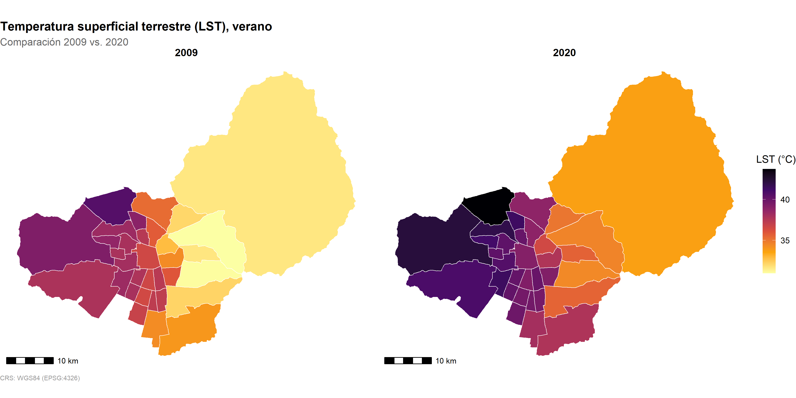
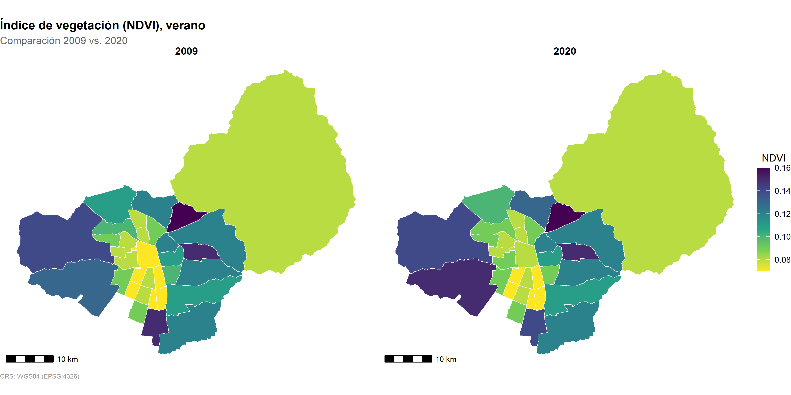
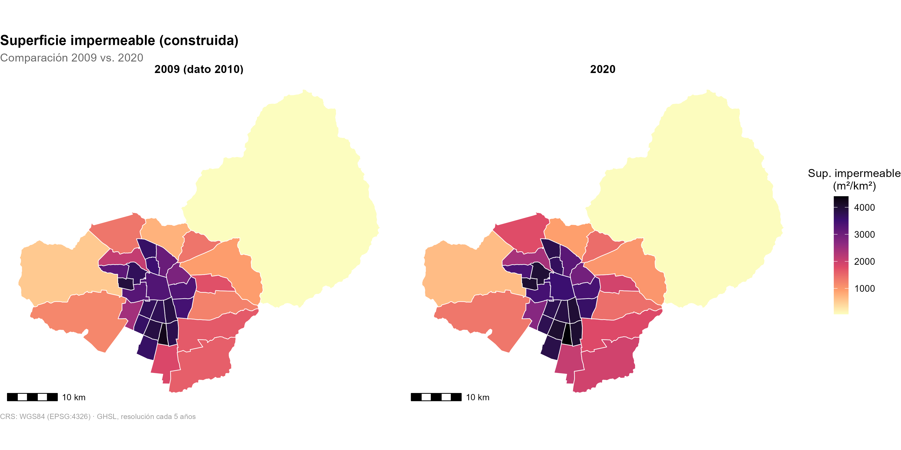

# Results / Resultados

## Figures / Figuras

**Figure 1 / Figura 1.** Summer land surface temperature by municipality, comparison between 2009 and 2020. Surface temperature increased in all 33 municipalities (mean +2.97 °C; range +2.03 to +3.91 °C). / Temperatura superficial de verano por comuna, comparación entre 2009 y 2020. Aumentó en las 33 comunas (promedio +2,97 °C; rango +2,03 a +3,91 °C).

**Figure 2 / Figura 2.** Vegetation (NDVI) by municipality, comparison between 2009 and 2020. NDVI shows limited variation among municipalities (0.06 to 0.18), consistent with a densely built urban area. / Vegetación (NDVI) por comuna, comparación entre 2009 y 2020. Muestra poca variación entre comunas (0,06 a 0,18), consistente con una zona urbana densamente construida.

**Figure 3 / Figura 3.** Impervious surface by municipality, comparison between 2009 and 2020. It increased in all municipalities, most in Quilicura, Puente Alto and Renca. Lo Barnechea shows the smallest change because much of its area is non-urbanizable mountain land, which dilutes the value calculated over the whole municipal area. / Superficie impermeable por comuna, comparación entre 2009 y 2020. Aumentó en todas las comunas, sobre todo en Quilicura, Puente Alto y Renca. Lo Barnechea muestra el menor cambio porque gran parte de su superficie es zona de montaña no urbanizable, lo que diluye el valor calculado sobre el área comunal total.

## Tables / Tablas

Tables 1 to 4 show the Cox models for the whole pregnancy, one block per built environment variable. The full tables are in [`Tables/tablas_periodo_total_centrado_con_todos.xlsx`](Tables/tablas_periodo_total_centrado_con_todos.xlsx). / Las Tablas 1 a 4 muestran los modelos de Cox de todo el embarazo, con un bloque por variable del ambiente construido. Las tablas completas están en el archivo Excel.

**Notes common to Tables 1 to 4 / Notas comunes a las Tablas 1 a 4.** Hazard ratios (HR) and 95% confidence intervals for preterm birth. The exposure is continuous and centered at its mean. *Bajo*, *Medio* and *Alto* are the terciles (low, medium, high) of each built environment variable, with the low tercil as reference. The first row of each block is the association of the exposure in the municipalities of the low tercil. The *Medio* and *Alto* rows compare each tercil with the low one at the mean exposure. Rows with × are interactions: values above 1 indicate that the environment strengthens the association of the exposure, and values below 1 that it weakens it. Models are adjusted for newborn sex, maternal and paternal age, education and occupation, municipal social vulnerability (SOVI) and year of birth. Row labels are in Spanish: *Vías* = roads, *Cobertura arbórea* = tree cover, *Sup. impermeable* = impervious surface, *Densidad* = population density, *Industrial* = industrial area, *LST verano / anual* = summer / annual land surface temperature. The left column includes the births of the relevant season, and the right column all births.

*Hazard ratios (HR) e intervalos de confianza del 95% para el parto prematuro. La exposición es continua y está centrada en su promedio. Bajo, Medio y Alto son los terciles de cada variable del ambiente construido, con el tercil bajo como referencia. La primera fila de cada bloque es la asociación de la exposición en las comunas del tercil bajo. Las filas Medio y Alto comparan cada tercil con el bajo con la exposición en su promedio. Las filas con × son interacciones: valores sobre 1 indican que el entorno refuerza la asociación de la exposición, y valores bajo 1, que la debilita. Los modelos se ajustan por sexo del recién nacido, edad, educación y situación laboral de la madre y del padre, vulnerabilidad social de la comuna (SOVI) y año de nacimiento. La columna izquierda incluye los nacimientos de la estación relevante, y la derecha, todos los nacimientos.*

**Table 1 / Tabla 1.** Maximum temperature (per 1 °C) × built environment. Summer births (Nov–Mar), n = 310,514; all births, n = 713,918. / Temperatura máxima (por 1 °C) × ambiente construido. Nacimientos de verano (nov–mar), n = 310.514; todos los nacimientos, n = 713.918.

[Table 1 (CSV) / Tabla 1 (CSV)](Tables/tabla_1_tmax_centrado.csv)

**Table 2 / Tabla 2.** PM2.5 (per 10 units) × built environment. Winter births (May–Aug), n = 225,438; all births, n = 713,918. / PM2.5 (por 10 unidades) × ambiente construido. Nacimientos de invierno (may–ago), n = 225.438; todos los nacimientos, n = 713.918.

[Table 2 (CSV) / Tabla 2 (CSV)](Tables/tabla_2_pm25_centrado.csv)

**Table 3 / Tabla 3.** NO2 (per 10 units) × built environment. Winter births (May–Aug), n = 225,438; all births, n = 713,918. / NO2 (por 10 unidades) × ambiente construido. Nacimientos de invierno (may–ago), n = 225.438; todos los nacimientos, n = 713.918.

[Table 3 (CSV) / Tabla 3 (CSV)](Tables/tabla_3_no2_centrado.csv)

**Table 4 / Tabla 4.** Ozone (per 1 unit) × built environment. Summer births (Nov–Mar), n = 310,514; all births, n = 713,918. / Ozono (por 1 unidad) × ambiente construido. Nacimientos de verano (nov–mar), n = 310.514; todos los nacimientos, n = 713.918.

[Table 4 (CSV) / Tabla 4 (CSV)](Tables/tabla_4_o3_centrado.csv)

