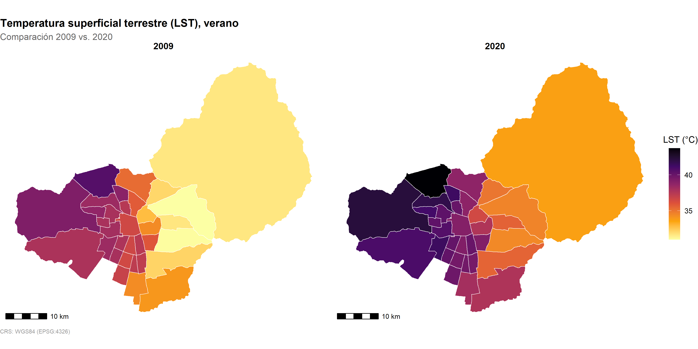
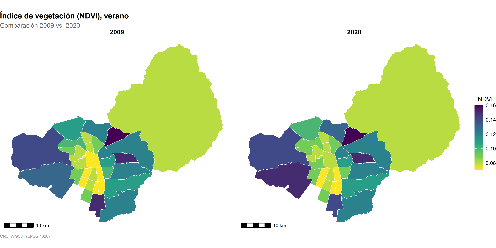

# Built Environment and Preterm Birth in Santiago, Chile (2009–2020)


**Fondecyt Nº 11240322**: Climate change and urban health: how air pollution, temperature, and city structure relate to preterm birth.

## 👥 Research Team

📬 **Estela Blanco** (estela.blanco@uc.cl) - **Principal Investigator**

📬 **Isidora Vidal** (isidora.vidal@ug.uchile.cl) - **Research Assistant / Geographer**

**Research Collaborators**: José Daniel Conejeros, Ismael Bravo

---

## 🌆 What is the Built Environment?

The **built environment** refers to the human-made physical surroundings in which we live, work, and move: buildings, streets, parks, industrial zones, transportation networks, together with the natural elements embedded within cities, such as vegetation, water bodies, and topography.

It is typically described through a set of interrelated components:

- **Green infrastructure**: parks, tree canopy, vegetation cover
- **Grey infrastructure**: impervious surfaces, buildings, roads
- **Urban form**: population density, land use, connectivity
- **Thermal environment**: surface temperature, heat retention
- **Socioeconomic fabric**: vulnerability, access to services, industrial activity

These components do not act in isolation. Together, they shape the everyday conditions in which people live and increasingly, research shows that **where we live has direct consequences for our health**, independent of individual behavior or genetics. Exposure to heat, pollution, or lack of green space during pregnancy, in particular, has been linked to adverse birth outcomes such as preterm birth.

This repository focuses on characterizing the built environment of the **33 urban municipalities of the Santiago Metropolitan Region**, Chile, identifying the variables that describe how each comuna is built, greened, and structured as a first step toward understanding whether these characteristics modify the relationship between extreme heat and preterm birth.

As an example, the maps below illustrate two dimensions of the built environment captured in this project: surface temperature, capturing the thermal environment shaped by urbanization and vegetation cover, a key indicator of green infrastructure.

**Surface Temperature Change (summer), 2009–2020**


**Vegetation Cover Change (NDVI), 2009–2020**



---

## 🎯 Project Overview

This section corresponds to **Objective 3** of Fondecyt N°11240322: to investigate how built environment characteristics (green space, heat, pollution, social vulnerability) modify the association between extreme heat and preterm birth, across the 33 urban municipalities of the Santiago Metropolitan Region, 2009–2020.

### Current Status

- ✅ Built environment database (Product 1) — complete, 33 municipalities × 2009–2020
- ✅ Consolidated analytical dataset (Product 2) — merges built environment + births
- 🔄 Descriptive maps and tables (Product 3) — in progress
- 🔄 Statistical analysis of effect modification — **in process**
- ⬜ Full reproducible repository (Product 4) — upcoming

---

## 📁 Repository Structure

```
PTB_Built_environment/
├── 01_Input/          # Datos de ambiente construido y base analítica
├── 02_Code/            # Scripts de procesamiento y análisis
├── 03_Output/          # Mapas, tablas y figuras
└── README.md
```

```
PTB_Built_environment/
├── PTB_Built_environment.Rproj   # open this file first in RStudio
├── 01_Input/
│   ├── Producto1/                # urban environment dataset, data dictionary and auxiliary CSVs
│   ├── NDVI/  LST/  Cobertura_Arborea/  Impervious/   # Earth Engine exports
│   ├── Salud_2019/  Parques_2013/  INE_población/
│   └── Shapefiles/               # commune boundaries, parks 2009 and 2019, municipal land-use plans
├── 02_Code/
│   ├── GEE/                      # Google Earth Engine scripts (.js)
│   └── R/                        # R scripts, numbered in project order
├── 03_Output/
│   ├── Maps/                     # maps and descriptive figures
│   └── Tables/                   # model tables
├── LICENSE
└── README.md
```

All paths are relative to the project root. Open the `.Rproj` file in RStudio and the scripts run without changing paths.

## 🧭 Execution Order

**Step 1 – Earth Engine (`02_Code/GEE`).** Export each table to Drive and save the CSV in `01_Input/`.

| Script | Output | Folder |
|---|---|---|
| `01_NDVI_comunas_santiago.js` | Summer and annual NDVI | `01_Input/NDVI` |
| `02_LST_comunas_santiago.js` | Summer and annual land surface temperature | `01_Input/LST` |
| `03_CoberturaArborea_comunas_santiago.js` | Tree cover | `01_Input/Cobertura_Arborea` |
| `04_SuperficieImpermeable_comunas_santiago.js` | Impervious surface | `01_Input/Impervious` |

**Step 2 – R (`02_Code/R`).** Run in numerical order. Scripts 01 to 08 save their output to `01_Input/Producto1`, which script 09 reads.

| Script | What it does | Requires |
|---|---|---|
| `01_SOVI_comunas` | Social vulnerability index (SOVI) | SOVI source file (research team) |
| `02_BHT_comunas`, `03_BHT_dimensiones` | Territorial well-being index and its dimensions | BHT files (CIT-UAI, via research team) |
| `04_parques_comunas` | Parks 2009, 2013 and 2019 | Park shapefiles (included) |
| `05_vias_principales` | Main road density | OpenStreetMap roads (download from Geofabrik) |
| `06_salud_comunas` | Health facilities 2019 | DEIS/MINSAL layer (included) |
| `07_industrias_comunas` | Industrial area | Municipal land-use plans (included) |
| `08_inmigrantes` | Immigrant population 2017 | INE Census 2017 layer (online) |
| `09_Producto1_integrar` | Builds the urban environment dataset (Product 1) | Outputs of steps 1 and 2 |
| `10_Producto2_integrar`, `11_Producto2_control_calidad` | Merges Product 1 with births; quality control | Birth records |
| `12_Diccionario_variables` | Data dictionary | – |
| `13_Producto3_mapas`, `15_Producto3_graficos` | Descriptive maps and plots | Product 1 + commune shapefile |
| `14_Ine_poblacion` | Population series 2009–2020 | INE projections (`ine_totales_rm.csv`, included) |
| `16_Modelo_analisis_modificacion_efecto` | Cox models, last gestational week | Product 2 + daily temperature and pollution data |
| `18_Modelo_analisis_centrado` | Cox models, whole pregnancy, centered exposure | Product 2 + daily temperature and pollution data |

## 📂 Data Availability

**Included in `01_Input`:**
- Urban environment dataset (Product 1), data dictionary and auxiliary CSVs (`Producto1`).
- Earth Engine exports: `NDVI`, `LST`, `Cobertura_Arborea`, `Impervious`. The models use summer NDVI (December to March); annual NDVI is also included.
- Shapefiles read by the scripts: commune boundaries, parks 2009, 2013 and 2019, health facilities 2019, and municipal land-use plans of the 33 communes.
- Population projections (`INE_población`).

**Not included:**
- Individual birth records (DEIS), which are confidential.
- Daily temperature and air pollution data, and the SOVI and BHT source files (`Data_ANID`), provided by the research team.
- OpenStreetMap roads (too large for GitHub). Download `chile-latest-free.shp` from [Geofabrik](https://download.geofabrik.de) and place `gis_osm_roads_free_1.*` in `01_Input/Shapefiles/OSM/`. The result, already computed, is in `Producto1/vias_principales_santiago_33.csv`.

Scripts 01, 02, 03, 10, 11, 16 and 18 need files that are not included and cannot be run from this repository alone.

## ⚙️ Requirements

R 4.4.1. Packages: `dplyr`, `readr`, `readxl`, `tidyr`, `tibble`, `purrr`, `stringr`, `sf`, `ggplot2`, `ggspatial`, `patchwork`, `gridExtra`, `gt`, `survival`, `slider`, `openxlsx`.

Earth Engine scripts load the 33 communes from a private asset. Upload the commune boundaries (`01_Input/Shapefiles/Comunas_santiago_33`) as an asset and update the path at the top of each script.

## 📖 Codebook

The full description of every variable (source, temporal coverage, unit, notes) is in `01_Input/Producto1/diccionario_variables.csv`.

| Group | Variables | Coverage |
|---|---|---|
| Vegetation | `ndvi_verano`, `ndvi_anual`, `cobertura_arborea` | Annual 2009–2020 |
| Land surface temperature | `lst_verano`, `lst_anual` | Annual 2009–2020 |
| Built surface | `sup_impermeable` | 2010, 2015, 2020 (nearest year assigned) |
| Roads and industry | `vias_km_por_km2`, `area_industrial_ha` | Static, repeated every year |
| Population | `poblacion_total`, `area_km2`, `densidad_hab_km2` | Annual 2009–2020 |
| Social vulnerability and well-being | `indice_vulnerabilidad`, `categoria_vulnerabilidad`, `bht`, `dim_socioeconomica`, `dim_accesibilidad`, `dim_ambiental`, `dim_seguridad` | 2017 |
| Migration | `pct_inmigrantes` | 2017 |
| Health access | `dist_salud_km`, `n_establecimientos_salud` | 2019 |
| Parks | `area_parques_ha`, `pct_parques` | 2009, 2013, 2019 (not comparable across years) |

## ✉️ Contact

For questions about the code or methodology in this section: Isidora Vidal (isidora.vidal@ug.uchile.cl).

## 📄 License

MIT License. See [LICENSE](LICENSE).

---
---

# Ambiente Construido y Parto Prematuro en Santiago, Chile (2009–2020)


**Fondecyt Nº 11240322**: Cambio climático y salud urbana: cómo la contaminación del aire, la temperatura y la estructura de la ciudad se relacionan con el parto prematuro.

## 👥 Equipo de Investigación

📬 **Estela Blanco** (estela.blanco@uc.cl) - **Investigadora Principal**

📬 **Isidora Vidal** (isidora.vidal@ug.uchile.cl) - **Asistente de Investigación / Geógrafa**

**Colaboradores de Investigación**: José Daniel Conejeros, Ismael Bravo

---

## 🌆 ¿Qué es el Ambiente Construido?

El **ambiente construido** se refiere al entorno físico creado por el ser humano en el que vivimos, trabajamos y nos movemos: edificios, calles, parques, zonas industriales, redes de transporte, junto con los elementos naturales presentes en la ciudad, como la vegetación, cuerpos de agua y la topografía.

Habitualmente se describe a través de un conjunto de componentes interrelacionados:

- **Infraestructura verde**: parques, cobertura arbórea, vegetación
- **Infraestructura gris**: superficies impermeables, edificaciones, vías
- **Forma urbana**: densidad poblacional, uso de suelo, conectividad
- **Ambiente térmico**: temperatura superficial, retención de calor
- **Tejido socioeconómico**: vulnerabilidad, acceso a servicios, actividad industrial

Estos componentes no actúan de forma aislada. En conjunto, dan forma a las condiciones cotidianas en las que vive la población y cada vez más evidencia muestra que **el lugar donde habitamos tiene consecuencias directas sobre nuestra salud**, independientemente del comportamiento individual o la genética. La exposición a calor, contaminación o falta de áreas verdes durante el embarazo, en particular, se ha asociado a resultados adversos del nacimiento como el parto prematuro.

Este repositorio se enfoca en caracterizar el ambiente construido de las **33 comunas urbanas de la Región Metropolitana de Santiago**, Chile, identificando las variables que describen cómo está construida, cuánto verde tiene y cómo se estructura cada comuna como primer paso para entender si estas características modifican la relación entre el calor extremo y el parto prematuro.

A modo de ejemplo, los mapas a continuación ilustran dos dimensiones del ambiente construido capturadas en este proyecto: la temperatura superficial, que demuestra el ambiente térmico moldeado por la urbanización y la cobertura de vegetación, un indicador de infraestructura verde.

**Cambio en Temperatura Superficial (verano), 2009–2020**


**Cambio en Cobertura de Vegetación (NDVI), 2009–2020**

---

## 🎯 Descripción del Proyecto

Esta sección corresponde al **Objetivo 3** del FONDECYT N°11240322: investigar cómo las características del ambiente construido (áreas verdes, calor, contaminación, vulnerabilidad social) modifican la asociación entre calor extremo y parto prematuro, en las 33 comunas urbanas de la Región Metropolitana de Santiago, período 2009-2020.

### Estado Actual

- ✅ Base de datos de ambiente construido (Producto 1) — completa, 33 comunas × 2009-2020
- ✅ Base analítica consolidada (Producto 2) — integra ambiente construido + nacimientos
- 🔄 Mapas y tablas descriptivas (Producto 3) — en curso
- 🔄 Análisis estadístico de modificación de efecto — **en proceso**
- ⬜ Repositorio reproducible completo (Producto 4) — próximamente

---

## 📁 Estructura del Repositorio

```
PTB_Built_environment/
├── 01_Input/ # Datos de ambiente construido y base analítica
├── 02_Code/ # Scripts de procesamiento y análisis
├── 03_Output/ # Mapas, tablas y figuras
└── README.md
```

```
PTB_Built_environment/
├── PTB_Built_environment.Rproj   # abrir este archivo primero en RStudio
├── 01_Input/
│   ├── Producto1/                # base de entorno urbano, diccionario y CSV auxiliares
│   ├── NDVI/  LST/  Cobertura_Arborea/  Impervious/   # resultados de Earth Engine
│   ├── Salud_2019/  Parques_2013/  INE_población/
│   └── Shapefiles/               # límites comunales, parques 2009 y 2019, planes reguladores comunales
├── 02_Code/
│   ├── GEE/                      # scripts de Google Earth Engine (.js)
│   └── R/                        # scripts de R, numerados según el orden del proyecto
├── 03_Output/
│   ├── Maps/                     # mapas y figuras descriptivas
│   └── Tables/                   # tablas de los modelos
├── LICENSE
└── README.md
```

Todas las rutas son relativas a la raíz del proyecto. Abre el archivo `.Rproj` en RStudio y los scripts se ejecutan sin cambiar rutas.

## 🧭 Orden de Ejecución

**Paso 1 – Earth Engine (`02_Code/GEE`).** Exportar cada tabla a Drive y guardar el CSV en `01_Input/`.

| Script | Resultado | Carpeta |
|---|---|---|
| `01_NDVI_comunas_santiago.js` | NDVI de verano y anual | `01_Input/NDVI` |
| `02_LST_comunas_santiago.js` | Temperatura superficial de verano y anual | `01_Input/LST` |
| `03_CoberturaArborea_comunas_santiago.js` | Cobertura arbórea | `01_Input/Cobertura_Arborea` |
| `04_SuperficieImpermeable_comunas_santiago.js` | Superficie impermeable | `01_Input/Impervious` |

**Paso 2 – R (`02_Code/R`).** Ejecutar en orden numérico. Los scripts 01 a 08 guardan su resultado en `01_Input/Producto1`, que lee el 09.

| Script | Qué hace | Requiere |
|---|---|---|
| `01_SOVI_comunas` | Índice de vulnerabilidad social (SOVI) | Archivo fuente del SOVI (equipo de investigación) |
| `02_BHT_comunas`, `03_BHT_dimensiones` | Índice de bienestar territorial y sus dimensiones | Archivos BHT (CIT-UAI, vía equipo de investigación) |
| `04_parques_comunas` | Parques 2009, 2013 y 2019 | Shapefiles de parques (incluidos) |
| `05_vias_principales` | Densidad de vías principales | Vías de OpenStreetMap (descargar de Geofabrik) |
| `06_salud_comunas` | Establecimientos de salud 2019 | Capa DEIS/MINSAL (incluida) |
| `07_industrias_comunas` | Superficie industrial | Planes reguladores comunales (incluidos) |
| `08_inmigrantes` | Población inmigrante 2017 | Capa del Censo 2017 del INE (en línea) |
| `09_Producto1_integrar` | Construye la base de entorno urbano (Producto 1) | Resultados de los pasos 1 y 2 |
| `10_Producto2_integrar`, `11_Producto2_control_calidad` | Une el Producto 1 con nacimientos; control de calidad | Registros de nacimientos |
| `12_Diccionario_variables` | Diccionario de variables | – |
| `13_Producto3_mapas`, `15_Producto3_graficos` | Mapas y gráficos descriptivos | Producto 1 + shapefile de comunas |
| `14_Ine_poblacion` | Serie de población 2009–2020 | Proyecciones del INE (`ine_totales_rm.csv`, incluido) |
| `16_Modelo_analisis_modificacion_efecto` | Modelos de Cox, última semana gestacional | Producto 2 + datos diarios de temperatura y contaminación |
| `18_Modelo_analisis_centrado` | Modelos de Cox, todo el embarazo, exposición centrada | Producto 2 + datos diarios de temperatura y contaminación |

## 📂 Disponibilidad de Datos

**Incluido en `01_Input`:**
- Base de entorno urbano (Producto 1), diccionario de variables y CSV auxiliares (`Producto1`).
- Resultados de Earth Engine: `NDVI`, `LST`, `Cobertura_Arborea`, `Impervious`. Los modelos usan el NDVI de verano (diciembre a marzo); también se incluye el NDVI anual.
- Shapefiles que leen los scripts: límites comunales, parques 2009, 2013 y 2019, establecimientos de salud 2019 y planes reguladores comunales de las 33 comunas.
- Proyecciones de población (`INE_población`).

**No incluido:**
- Registros individuales de nacimientos (DEIS), que son confidenciales.
- Datos diarios de temperatura y contaminación, y archivos fuente del SOVI y el BHT (`Data_ANID`), entregados por el equipo de investigación.
- Vías de OpenStreetMap (demasiado grandes para GitHub). Descargar `chile-latest-free.shp` desde [Geofabrik](https://download.geofabrik.de) y ubicar `gis_osm_roads_free_1.*` en `01_Input/Shapefiles/OSM/`. El resultado ya calculado está en `Producto1/vias_principales_santiago_33.csv`.

Los scripts 01, 02, 03, 10, 11, 16 y 18 requieren archivos que no están incluidos y no pueden ejecutarse solo con este repositorio.

## ⚙️ Requisitos

R 4.4.1. Paquetes: `dplyr`, `readr`, `readxl`, `tidyr`, `tibble`, `purrr`, `stringr`, `sf`, `ggplot2`, `ggspatial`, `patchwork`, `gridExtra`, `gt`, `survival`, `slider`, `openxlsx`.

Los scripts de Earth Engine cargan las 33 comunas desde un asset privado. Sube los límites comunales (`01_Input/Shapefiles/Comunas_santiago_33`) como asset y actualiza la ruta al inicio de cada script.

## 📖 Libro de Códigos

La descripción completa de cada variable (fuente, cobertura temporal, unidad, notas) está en `01_Input/Producto1/diccionario_variables.csv`.

| Grupo | Variables | Cobertura |
|---|---|---|
| Vegetación | `ndvi_verano`, `ndvi_anual`, `cobertura_arborea` | Anual 2009–2020 |
| Temperatura superficial | `lst_verano`, `lst_anual` | Anual 2009–2020 |
| Superficie construida | `sup_impermeable` | 2010, 2015, 2020 (se asigna el año más cercano) |
| Vías e industria | `vias_km_por_km2`, `area_industrial_ha` | Estática, repetida todos los años |
| Población | `poblacion_total`, `area_km2`, `densidad_hab_km2` | Anual 2009–2020 |
| Vulnerabilidad social y bienestar | `indice_vulnerabilidad`, `categoria_vulnerabilidad`, `bht`, `dim_socioeconomica`, `dim_accesibilidad`, `dim_ambiental`, `dim_seguridad` | 2017 |
| Migración | `pct_inmigrantes` | 2017 |
| Acceso a salud | `dist_salud_km`, `n_establecimientos_salud` | 2019 |
| Parques | `area_parques_ha`, `pct_parques` | 2009, 2013, 2019 (no comparables entre años) |

## 📄 Licencia

Licencia MIT. Ver [LICENSE](LICENSE).
